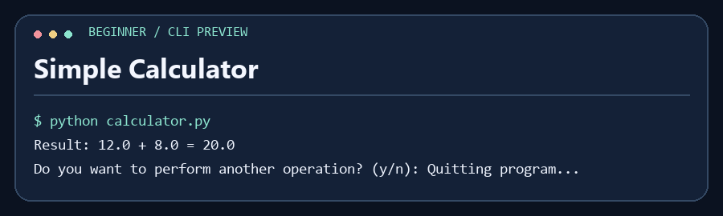
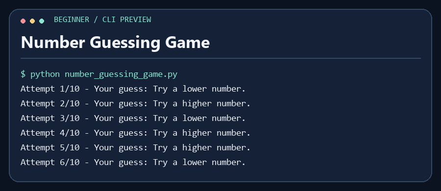
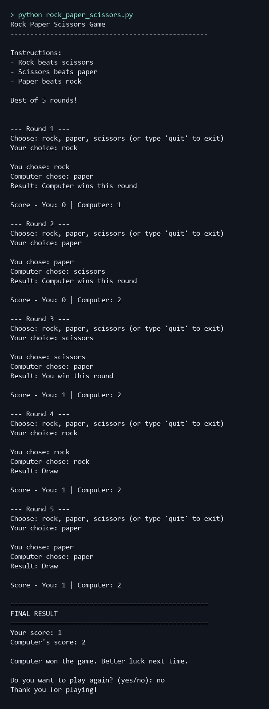
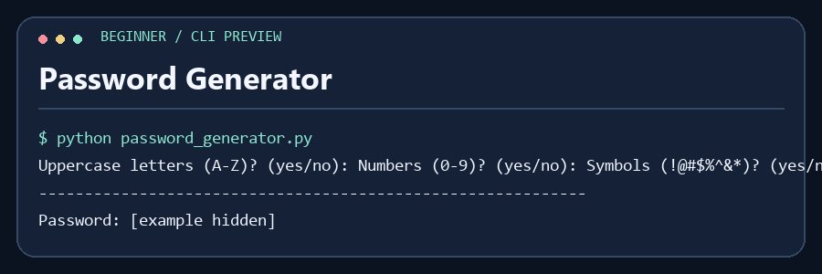
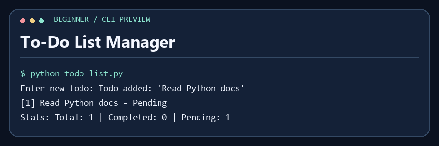
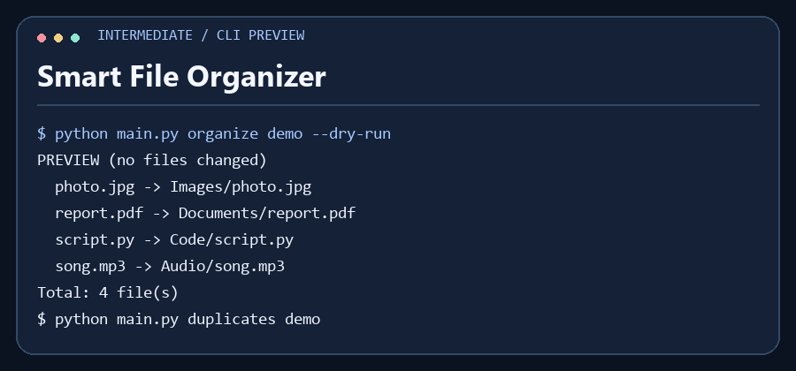
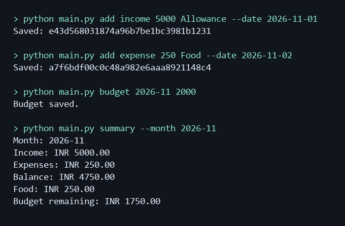
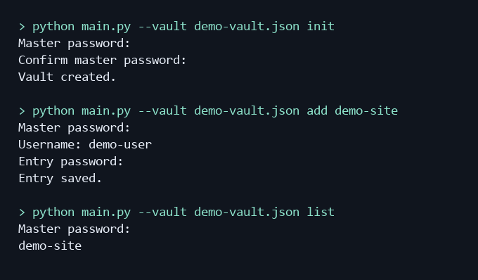
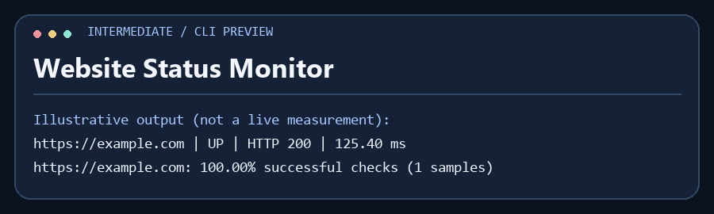
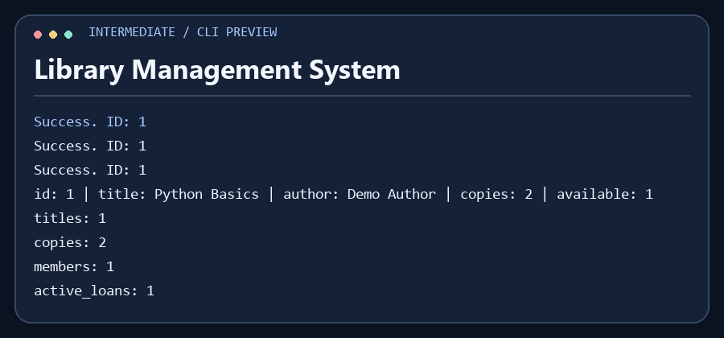

# Python CLI Projects — Beginner to Intermediate

Learn Python through ten command-line projects covering programming fundamentals, file automation, expense tracking and modular applications with unit tests.

Ten Python command-line projects, from single-file exercises to modular applications with automated tests. This repository is the final collection.

Each project image shows terminal output captured from a live run with demo inputs. The Website Status Monitor checks a local HTTP server.

## Project index

| Beginner projects | Intermediate projects |
| --- | --- |
| [Simple Calculator](#simple-calculator) | [Smart File Organizer](#smart-file-organizer) |
| [Number Guessing Game](#number-guessing-game) | [Personal Expense Tracker](#personal-expense-tracker) |
| [Rock Paper Scissors](#rock-paper-scissors) | [Secure Password Vault](#secure-password-vault) |
| [Password Generator](#password-generator) | [Website Status Monitor](#website-status-monitor) |
| [To-Do List Manager](#to-do-list-manager) | [Library Management System](#library-management-system) |

## Repository structure

```text
Python-Projects/
|-- README.md
|-- assets/previews/
|   |-- beginner/
|   `-- intermediate/
|-- beginner/
|   |-- README.md
|   |-- calculator.py
|   |-- number_guessing_game.py
|   |-- rock_paper_scissors.py
|   |-- password_generator.py
|   `-- todo_list.py
`-- intermediate/
    |-- library-management-system/
    |-- personal-expense-tracker/
    |-- secure-password-vault/
    |-- smart-file-organizer/
    `-- website-status-monitor/
```

Each intermediate folder contains a `main.py` entry point, a Python package, a project README, a dependency file, a sample terminal transcript and a `tests/` directory.

## Quick start

Use **Python 3.10 or later**. The vault requires `cryptography`. The other nine projects use the Python standard library.

```sh
git clone https://github.com/krushnakaale/Python-Projects.git
cd Python-Projects
python beginner/calculator.py
```

To explore a modular application or run its tests, open its project directory. For example, from the repository root:

```sh
cd intermediate/library-management-system
python main.py --help
python -m unittest discover -s tests -v
```

For the vault, follow the setup instructions in its project guide before running commands or tests.

## Beginner projects

### Simple Calculator

Four arithmetic operations with numeric input validation. **Python concepts:** Functions, loops and exception handling.

Run `python beginner/calculator.py` from the repository root. [Source](beginner/calculator.py)



### Number Guessing Game

Guess a number from 1 to 100 in up to ten tries, with higher/lower hints and scoring. **Python concepts:** Random numbers, conditionals and game state.

Run `python beginner/number_guessing_game.py` from the repository root. [Source](beginner/number_guessing_game.py)



### Rock Paper Scissors

Play five rounds against the computer and see the running and final scores. **Python concepts:** Random choices, comparisons and score tracking.

Run `python beginner/rock_paper_scissors.py` from the repository root. [Source](beginner/rock_paper_scissors.py)



### Password Generator

Choose a length and character sets, then see the generated password and its estimated strength. **Python concepts:** String handling and pseudorandom selection for a learning exercise.

Run `python beginner/password_generator.py` from the repository root. [Source](beginner/password_generator.py)



### To-Do List Manager

Add, complete and delete tasks, clear completed items and save changes to `todos.json`. **Python concepts:** Classes, JSON persistence and CRUD operations.

Run `python beginner/todo_list.py` from the repository root. [Source](beginner/todo_list.py)



## Intermediate projects

### Smart File Organizer

Sort files by extension with a dry-run preview, collision protection and an undo journal. Find exact duplicates with SHA-256. **Python concepts:** `argparse`, `pathlib`, hashing and operation journals.

[Setup and commands](intermediate/smart-file-organizer/README.md) · [Source package](intermediate/smart-file-organizer/smart_file_organizer/) · [Sample output](intermediate/smart-file-organizer/examples/sample-output.txt)



### Personal Expense Tracker

Track income and expenses in INR, set monthly budgets, review category summaries and export CSV reports. **Python concepts:** `Decimal` arithmetic, JSON and CSV.

[Setup and commands](intermediate/personal-expense-tracker/README.md) · [Source package](intermediate/personal-expense-tracker/expense_tracker/) · [Sample output](intermediate/personal-expense-tracker/examples/sample-output.txt)



### Secure Password Vault

Demonstrate local credential management with a master password, masked prompts and encrypted storage. **Python concepts:** Scrypt key derivation and Fernet authenticated encryption.

[Setup and commands](intermediate/secure-password-vault/README.md) · [Source package](intermediate/secure-password-vault/password_vault/) · [Sample output](intermediate/secure-password-vault/examples/sample-output.txt)



### Website Status Monitor

Check HTTP(S) status and latency, review historical availability and export checks as CSV. **Python concepts:** `urllib`, timed polling and JSON Lines.

[Setup and commands](intermediate/website-status-monitor/README.md) · [Source package](intermediate/website-status-monitor/website_monitor/) · [Sample output](intermediate/website-status-monitor/examples/sample-output.txt)



### Library Management System

Manage books and members, issue and return loans, and view overdue items and inventory statistics. **Python concepts:** SQLite, parameterized SQL and relational constraints.

[Setup and commands](intermediate/library-management-system/README.md) · [Source package](intermediate/library-management-system/library_system/) · [Sample output](intermediate/library-management-system/examples/sample-output.txt)



## License

The Smart File Organizer includes an [MIT license](intermediate/smart-file-organizer/LICENSE).

## Developer

<div align="center">

### Krushna Kale

*Python developer and open-source enthusiast*

I build practical command-line tools and use this collection to practice modular design, local data storage and automated testing.

[](https://github.com/krushnakaale)
[](https://www.linkedin.com/in/krushnakaale/)
[](https://www.instagram.com/krushnakaale/)

</div>
